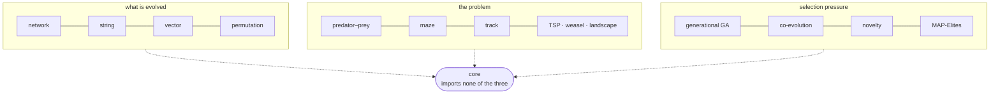

<p align="center">
  
</p>

<p align="center">
  <b>An evolutionary engine that does not know what it is evolving.</b><br>
  <sub>One unchanged core evolves neural networks, strings, number vectors and routes across interchangeable problems. Hand-written TypeScript, zero runtime dependencies, live in your browser.</sub>
</p>

<p align="center">
  <sub>
    <a href="#overview">OVERVIEW</a> &nbsp;·&nbsp;
    <a href="#quick-start">QUICK START</a> &nbsp;·&nbsp;
    <a href="#how-it-works">HOW IT WORKS</a> &nbsp;·&nbsp;
    <a href="#the-five-plates">THE FIVE PLATES</a> &nbsp;·&nbsp;
    <a href="#the-result-nobody-tuned-for">THE RESULT</a> &nbsp;·&nbsp;
    <a href="#honest-caveats">CAVEATS</a>
  </sub>
</p>

<br>

<table>
  <tr>
    <td><sub>RUNTIME DEPENDENCIES</sub><br><b>0</b></td>
    <td><sub>GENOME TYPES</sub><br><b>4</b></td>
    <td><sub>ENVIRONMENTS</sub><br><b>9 (5 on screen)</b></td>
    <td><sub>SEARCH</sub><br><b>GA · co-evolution · novelty · MAP-Elites</b></td>
    <td><sub>SAME SEED</sub><br><b>byte-identical run</b></td>
  </tr>
</table>

## Overview

No TensorFlow, no ML library, no rendering framework. The claim being tested is simple: an evolutionary engine can be made completely blind to *what* it evolves and *which* problem it solves.

The breadth of what it handles is the proof.

## Quick start

```bash
npm install
npm run dev          # opens on the predator–prey arms race
npm test
npm run build        # a static bundle with zero runtime dependencies
```

## How it works

Three axes that never touch each other:



- **`Genome`** is what is evolved. **`Environment`** is the problem. **`SearchStrategy`** decides who survives.
- **The core imports nothing** from `genomes/`, `environments/` or `search/`. That is enforced by construction, not convention.
- **The same seed always reproduces a byte-identical run.**

## The five plates

The demo is a set of specimen plates. Every one runs through the same core.

| Plate | Environment | Genome | What it proves |
|:-:|---|---|---|
| I | **Predator–prey** | two networks | Competitive co-evolution, a live arms race |
| II | **Weasel** | string | A genome with no network plugs straight in |
| III | **Travelling salesman** | permutation | Order crossover keeps every route valid |
| IV | **Track runner** | network | Champion, median and worst each drive one lap |
| V | **Maze** | network | A deceptive dead end, with fading crash markers |

> [!NOTE]
> Track runner and maze are **round-paced**: one generation is each role's full attempt. So the counter and the crash markers always describe the attempt you just watched, never a stale snapshot. Speed (0.25× to 8×) changes how fast it plays, not how often it is summarised.

Landscape, cart-pole, gait and XOR were taken off the screen, because five plates read better than nine. They were not taken out of the project.

## The result nobody tuned for

Two environments accept an **injected encoding**, so the identical, unmodified GA can evolve two unrelated representations of the same problem. Twenty seeds each, with the problem held fixed:

```bash
npm run experiment -- --study cross-representation --seeds 0-19
```

| Problem | Encoding | Final fitness, median | Generations to 0.9 |
|---|---|---|---|
| TSP, 20 nodes | Order-crossover permutation (original) | 0.184 | |
| TSP, 20 nodes | **Random keys**, a vector sorted into a tour | **0.195** | |
| Rastrigin 2D | Real-coded (original) | 0.99997 | 12 |
| Rastrigin 2D | **Binary-coded**, 16 bits per dimension | 0.99998 | **9** |

Both alternative encodings beat the ones the engine shipped with, and neither was tuned for.

- Random keys found routes about **7% shorter**, with no route-aware genetics at all: ordinary vector crossover, decoded by sorting.
- Binary coding reached the global basin in fewer generations, using genetics written for the Weasel phrase and reused without a single change.

## Honest caveats

> [!WARNING]
> The maze study does **not** reproduce the textbook Lehman and Stanley (2011) result where objective search gets stuck forever. At this maze's scale both strategies solve 20 of 20 seeds at the same median generation. The labels say so rather than overclaim.

- The maze plate renders only the objective GA; novelty search runs on the same maze from the command line.
- No performance benchmarks are claimed. Numbers appear only after they are measured.

<details>
<summary><b>Documents</b></summary>
<br>

| | |
|---|---|
| [PRD](docs/Project-Darwin-PRD.md) | Requirements and the thesis |
| [Architecture](docs/ARCHITECTURE.md) | The three axes and their interfaces |
| [Environments](docs/ENVIRONMENTS.md) | Every environment, specified |
| [Research](docs/RESEARCH.md) | The lineage, and the open question |

</details>

<sub>MIT.</sub>
